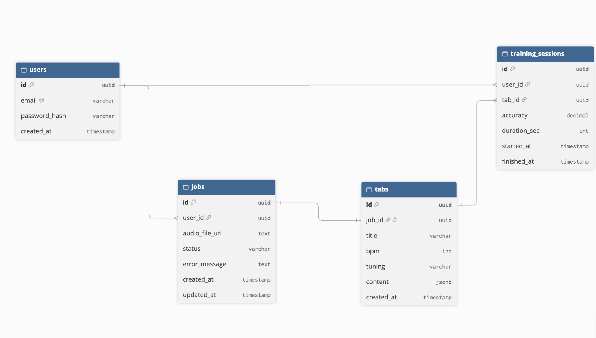

**Основные сущности базы данных**

**- User (Пользователь)**

- Хранит аутентификационные данные и профиль.

*- Связи:* один ко многим с Job и TrainingSession.

**- Job (Задача на генерацию)**

> - Основная связь между фронтом и нейросетью. Поскольку генерация табулатуры из аудио долгий процесс, то лучше не делать это в рамках одного HTTP-запроса. Фронт загружает файл, получает job_id и потом опрашивает статус.
>
> *- Связи:* многие к одному с User. Один к одному (или один ко многим, если НС генерирует несколько вариантов) с Tab.

**- Tab (Готовая табулатура)**

> - Результат работы нейросети. Лучше хранить не просто текст, а структурированные данные (JSONB в PostgreSQL), чтобы фронт мог красиво отрисовать гриф, или бинарные данные.

*- Связи:* один к одному с Job. Один ко многим с TrainingSession.

**- TrainingSession (Сессия тренировки)**

> - Логирование прогресса пользователя. Когда он играет под сгенерированную табулатуру, мы считаем точность и сохраняем результат для геймификации и статистики.

*- Связи:* многие к одному с User и Tab.

**API-контракты (REST)**

Используем версионирование (/api/v1/). Все эндпоинты, кроме регистрации/логина, должны быть защищены JWT-токеном.

**Загрузка файла (Upload)**

- **Эндпоинт:** POST /api/v1/audio/upload

- **Content-Type:** multipart/form-data

- **Тело запроса:** file (аудиофайл: mp3, wav).

- **Логика Go-фасада:**

  1.  Валидация файла (тип, размер).

  2.  Загрузка файла в S3/MinIO.

  3.  Создание записи в таблице Job со статусом pending.

  4.  Отправка сообщения в очередь (RabbitMQ/Redis) для воркера с нейросетью.

> **Нужный ответ (202 Accepted):**
>
> {
>
> "job_id": "550e8400-e29b-41d4-a716-446655440000",
>
> "message": "File uploaded, processing started"
>
> }

**Проверка статуса обработки (Status)**

- **Эндпоинт:** GET /api/v1/jobs/{job_id}/status

- **Логика:** Go читает статус из БД. Если нейросеть уже обработала файл, она обновила статус в БД через своего воркера.

- **Нужный ответ (200 OK):**

> {
>
> "job_id": "550e8400...",
>
> "status": "processing", // ну или же "pending", "completed", "failed"
>
> "progress": 65, // опционально, если НС умеет отдавать проценты
>
> "error_message": null
>
> }

**Получение готовой табулатуры (Get Tab)**

- **Эндпоинт:** GET /api/v1/jobs/{job_id}/tab (или GET /api/v1/tabs/{tab_id})

> **- Логика:** проверяем, что статус job = completed. Достаем данные табулатуры.

**- Ответ (200 OK):**

{

"tab_id": "770e8400...",

"title": "Generated Tab",

"bpm": 120,

"tuning": "EADGBE",

"content": { ... } // - структурированный JSONB с нотами/табами

}

**Сохранение результата тренировки**

**- Эндпоинт:** POST /api/v1/training/sessions

**- Тело запроса:** { "tab_id": "...", "accuracy": 87.5, "duration_sec": 140 }

**- Ответ (201 Created):**

{ "session_id": "..." }

**Схема PostgreSQL:**

